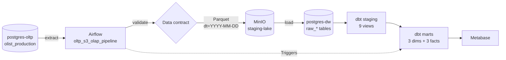

# ecommerce-elt-pipeline

An ELT pipeline that moves the [Olist Brazilian e-commerce dataset](https://www.kaggle.com/datasets/olistbr/brazilian-ecommerce)
out of a simulated production database, through an object-storage lake, into an analytics
warehouse, where dbt models it into a star schema that Metabase reads.

The point of the architecture is that **analysts never touch the OLTP database**. Every hop
exists to protect something: the lake gives you replayability, the contract gives you
schema-drift protection, the star schema gives you fast joins, the tests give you a build
that fails loudly instead of silently.

> Build order, phase by phase, with the verification step for each:
> **[IMPLEMENTATION.md](IMPLEMENTATION.md)**

## Architecture



The dotted `Airflow -. Triggers .-> dbt marts` edge is **aspirational**. `dags/elt_pipeline_minio.py`
contains extract and load tasks only — dbt is run by hand from your terminal in Phase 6.
That gap, and five others where intent and code diverge, are catalogued in
[IMPLEMENTATION.md Phase 0](IMPLEMENTATION.md#phase-0--orientation). Read it before you
wait for something that will never happen.

## Services

| Service | Image | Host port | Role | Credentials |
|---|---|---|---|---|
| `postgres-oltp` | postgres:13 | 5433 | Simulated production database | `admin` / `admin_password`, db `olist_production` |
| `postgres-dw` | postgres:13 | 5434 | Analytics warehouse | `dw_admin` / `dw_password`, db `analytics_warehouse` |
| `minio` | minio/minio | 9000 API, 9001 console | S3-compatible data lake | `minioadmin` / `minioadmin` |
| `postgres-airflow` | postgres:13 | — | Airflow's own metadata DB | `airflow` / `airflow` |
| `airflow` | apache/airflow:2.7.1 | 8080 | Orchestration | `airflow` / `airflow` |
| `metabase` | metabase/metabase | 3000 | BI | set on first visit |

Both database connections are injected into Airflow as `AIRFLOW_CONN_*` environment
variables, so there is nothing to configure in the Airflow UI.

## Quickstart

```bash
# Phase 1 -- data (needs a Kaggle API token at ~/.kaggle/kaggle.json)
uv sync
uv run kaggle datasets download -d olistbr/brazilian-ecommerce -p raw_data --unzip
ls raw_data/*.csv | wc -l          # expect 9

# Phase 2 -- infrastructure (first boot takes 3-5 minutes)
docker compose up -d
docker compose logs -f airflow

# Phase 3 -- seed the source database
uv run python init_oltp_db.py
```

Then open Airflow at <http://localhost:8080>, unpause `oltp_s3_olap_pipeline`, and trigger
it. Phases 4 onward are in [IMPLEMENTATION.md](IMPLEMENTATION.md).

## Layout

```
dags/
  elt_pipeline_minio.py    18 tasks: extract_<table>_to_minio >> load_<table>_to_dw
  contracts/orders.json    the one data contract that exists
init_oltp_db.py            host script: 9 CSVs -> postgres-oltp
docker-compose.yml         the six services
requirements.txt           installed inside the Airflow container
pyproject.toml             host-side deps (uv)
dbt_ecommerce/             not built yet -- Phase 6
```

Use `docker compose stop` rather than `down` between sessions. Named volumes make `down`
survivable now, but stopping is still cheaper.
