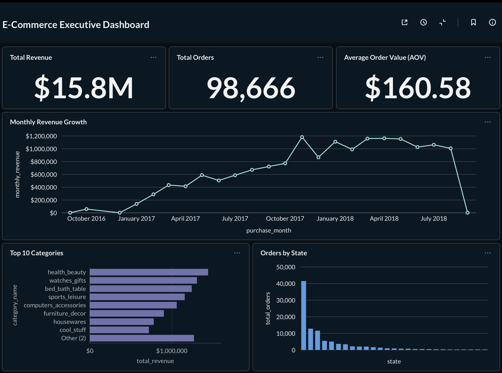
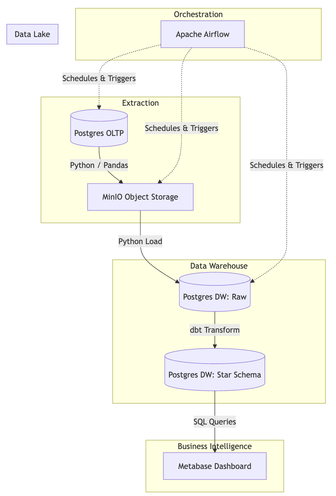
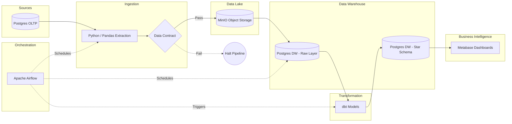

# E-Commerce ELT Pipeline




This project simulates a high-volume e-commerce business environment where transactional data is generated continuously. Instead of running slow, complex analytical queries directly against the production database, this solution implements an automated ELT (Extract, Load, Transform) pipeline. It extracts raw operational data, strictly validates it against Data Contracts, stages it securely in a Data Lake, and uses dbt to model a highly efficient Star Schema in a PostgreSQL Data Warehouse.

The pipeline is fully containerized and orchestrated via Apache Airflow to handle daily incremental loads without manual intervention.

## Business Problem

An e-commerce company processes thousands of orders daily, resulting in heavily normalized transactional data scattered across multiple operational tables. Previously, analysts struggled to generate daily reports because:
- Querying the production OLTP database directly caused performance bottlenecks.
- Complex `JOIN` operations across massive tables resulted in slow dashboard load times.
- There was no historical tracking or way to handle late-arriving delivery updates efficiently.
- Rebuilding analytical tables from scratch every day was wasting compute resources.
- Upstream schema changes (e.g., software engineers modifying production tables) frequently broke downstream dashboards silently.

The company needed a robust, automated Modern Data Stack to:
- Safely extract data without impacting production.
- Enforce strict Data Contracts to prevent silent schema drift.
- Model the data into a business-ready Star Schema tracking Sales, Payments, and Reviews.
- Intelligently process only *new* or *updated* records (Incremental processing).
- Serve a fast, highly available dashboard for executive metrics.

## The Dataset: Olist Brazilian E-Commerce

This project utilizes the **[Brazilian E-Commerce Public Dataset by Olist](https://www.kaggle.com/datasets/olistbr/brazilian-ecommerce)**, a widely recognized real-world dataset hosted on Kaggle. 

**Why this dataset?**
It contains roughly 100,000 orders made across multiple marketplaces in Brazil from 2016 to 2018. Its heavily normalized structure spread across 9 distinct tables perfectly mirrors a complex, messy operational database. This makes it an ideal candidate for demonstrating robust ELT extraction, data quality testing, and Star Schema modeling.

## Architecture & Tech Stack

### Pipeline Architecture
<!--  -->


| Component                   | Technology                  |
| -----------------------     | --------------------------- |
| Orchestration               | Apache Airflow              |
| Extraction                  | Python                      |
| Data Quality (Ingestion)    | JSON Schema (Data Contracts) |
| Data Lake (Storage)         | MinIO (S3-Compatible)       |
| Data Warehouse              | PostgreSQL                  |
| Transformation & Testing    | dbt (Data Build Tool)       |
| Business Intelligence       | Metabase                    |
| Infrastructure              | Docker & Docker Compose     |


## Key Engineering Highlights

### 1. Shift-Left Data Quality (Data Contracts)
To protect the data lake from upstream schema drift, the pipeline enforces strict JSON-based Data Contracts at the point of extraction. Using jsonschema, the Airflow extraction task validates column names, data types, and enum constraints before data is serialized to Parquet. If an upstream software engineer introduces a breaking change (e.g., dropping a critical column), the pipeline halts immediately, preventing silent corruption of downstream BI dashboards. *(All nine tables ship a contract in `dags/contracts/`. Validation runs on a 2,000-row random sample rather than the full extract, and records are passed to `jsonschema` with their types intact -- numerics stay numeric -- so the `integer`, `number` and `minimum` assertions do real work. A table with no contract file is bypassed with a logged warning.)*

### 2. Advanced dbt Incremental Modeling
Instead of relying on computationally expensive full-table scans, the `fact_sales` model utilizes dbt's `incremental` materialization. 
* Implemented a synthetic `updated_at` high-water mark.
* The pipeline efficiently processes only new orders and late-arriving delivery updates using complex `MERGE` logic, saving compute resources and reducing pipeline execution time.

### 3. Idempotent Data Lake Architecture
Utilized **MinIO** as an intermediate staging layer. By writing data to object storage before loading it into the warehouse, the pipeline ensures fault tolerance and allows for historical backfilling without hammering the source transactional database.

### 4. Fully Containerized Environment
The entire stack (Airflow, MinIO, Postgres OLTP, Postgres DW, and Metabase) is defined in a single `docker-compose.yml` file, ensuring perfect environment parity and isolated container networking.

### 5. Automated dbt Testing Suite
Every model build is gated by dbt's built-in schema tests, defined declaratively in `schema.yml`. All four dimensions get `unique` + `not_null` on their primary keys. `fact_sales` gets `not_null` plus `relationships` (referential integrity) on its three foreign keys -- the tests that catch a join silently dropping revenue. `fact_payments` and `fact_reviews` add `accepted_values` on `payment_type` and the 1-5 `review_score` scale. 24 tests run on every `dbt test`, and Airflow runs them automatically after each load.

## Project Structure
```text
ECOMMERCE_ELT_PROJECT/
├── dags/                       # Airflow DAGs for orchestrating the ELT workflow
│   ├── contracts/              # One JSON Data Contract per source table (9)
│   │   ├── orders.json
│   │   └── ...
│   └── elt_pipeline_minio.py   # 18 extract/load tasks, then dbt run + dbt test
├── dbt_ecommerce/              # dbt project containing SQL models and schema tests
│   ├── models/
│   │   ├── staging/            # Base views cleaning raw DW data (9)
│   │   └── marts/              # Star Schema: 4 dimensions, 3 facts
│   ├── dbt_project.yml
│   └── profiles.yml            # Env-var driven; works in-container and on the host
├── docker-compose.yml          # Containerized Infrastructure as Code
├── generate_synthetic_olist.py # Stand-in dataset when Kaggle is unavailable
├── init_oltp_db.py             # Simulates production DB seeding
├── assets/                     # Architecture diagrams and dashboard screenshots
├── IMPLEMENTATION.md           # Phase-by-phase build order with verification steps
├── NOTES.md                    # Study notes on the concepts behind each hop
├── pyproject.toml              # Host-side dependencies (uv)
└── requirements.txt            # Container-side dependencies (Airflow image)
```
## How to Run Locally
**1. Clone the repository:**
```bash
git clone https://github.com/amruth1181/ecommerce-elt-pipeline.git
cd ecommerce-elt-pipeline
```
**2. Get the source data:**

Either download the [Olist dataset](https://www.kaggle.com/datasets/olistbr/brazilian-ecommerce)
from Kaggle and extract the nine CSVs into `raw_data/`, or generate a stand-in
set with the same filenames, columns and row counts:

```bash
uv sync
uv run python generate_synthetic_olist.py
```

**3. Start the infrastructure (Docker):**
Ensure Docker Desktop is running, then spin up the stack:
```bash
docker compose up -d
```
First boot takes 3-5 minutes: Airflow installs `requirements.txt`, provisions a
separate virtualenv for dbt, migrates its metadata DB, and creates the admin user.

**4. Seed the source database:**
```bash
uv run python init_oltp_db.py
```
Host and container dependencies are deliberately separate. `requirements.txt` is
installed inside the Airflow image and pins what its Python 3.10 needs;
`pyproject.toml` holds the host set, resolved by uv against Python 3.12.

**5. Trigger the Airflow DAG:**
Navigate to ```http://localhost:8080``` (credentials: ```airflow``` / ```airflow```). Enable and trigger the ```oltp_s3_olap_pipeline``` DAG. It runs 18 extract/load tasks, then `dbt_run` and `dbt_test`. *Note: open the logs for `extract_orders_to_minio` to watch the Data Contract validation pass before the upload to MinIO.*

**6. Verify the Data Lake (MinIO):**
Once the Airflow DAG runs successfully, you can verify that the raw data was successfully extracted and staged in the Data Lake.
1. Navigate to `http://localhost:9001` to access the MinIO Console.
2. Log in using the default credentials:
   - **Username:** `minioadmin`
   - **Password:** `minioadmin`
3. Click on the **Object Browser** to view the staging buckets and the newly landed raw data files.

**7. The transformations run themselves:**

`dbt run` and `dbt test` are the last two tasks in the DAG, so triggering
`oltp_s3_olap_pipeline` builds the star schema and gates it with the test suite
without any manual step. `dbt_ecommerce/profiles.yml` is committed and reads
`DBT_HOST` / `DBT_PORT` from the environment, which is why the same file works
inside the container (`postgres-dw:5432`) and from your host.

**8. Running dbt by hand (optional):**
```bash
uv sync --group dbt
cd dbt_ecommerce
uv run dbt run --profiles-dir .    # add --full-refresh to rebuild fact_sales
uv run dbt test --profiles-dir .   # expect PASS=24
```
From the host, `profiles.yml` falls back to `localhost:5434` -- the DW's
published port. Pointing it at 5433 hits the OLTP database instead, where no
`raw_*` tables exist, and dbt reports a confusing "source not found".

**9. Explore the Data (Optional):**
To explore the finalized Star Schema and build your own visualizations:
1. Navigate to `http://localhost:3000` to access the Metabase UI.
2. Set up an admin account.
3. Add a new PostgreSQL database connection using:
   - **Host:** `postgres-dw`
   - **Port:** `5432`
   - **Database Name:** `analytics_warehouse`
   - **Username:** `dw_admin`
   - **Password:** `dw_password`

*(Note: The pre-built dashboard is saved locally. You can view the final visualization screenshots at the top of this README).*

---

## Credits

Built on top of [rtmagar/ecommerce-elt-pipeline](https://github.com/rtmagar/ecommerce-elt-pipeline)
by Rahul Thapa Magar, which contributed the original architecture, DAG and dbt models.
See [NOTICE](NOTICE) for the split of work.
